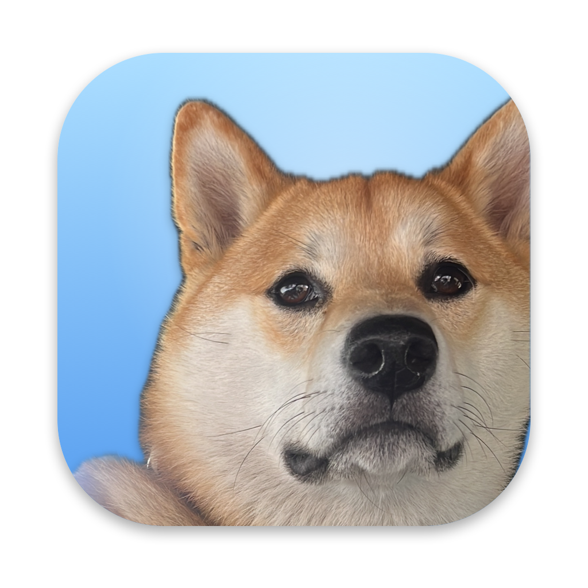

<div align="center">



# JubTab

**My opinionated window switcher for macOS.**<br/>
⌘Tab through windows. ⌥Tab through everything else I work in: local dev servers, cmux workspaces and Zen tabs.

</div>

JubTab is my personal fork of [AltTab](https://github.com/lwouis/alt-tab-macos) by Louis Pontoise. It keeps upstream's excellent window switcher and changes the parts I care about. It's built for one setup (mine: Zen, cmux, a pile of localhost servers), so expect opinions rather than options.

## What's different

- **⌥Tab — the Jump switcher.** Hold ⌥ and press Tab to see:
  - **Servers** — every local port that serves a web page, named by the page's title and linked to the cmux workspace it runs in. Picking one switches to the Zen tab already showing it, or opens one.
  - **cmux** — workspaces, most recent first, with their folder and ports.
  - **Zen** — open tabs, most recent first.

  Tab / ⇧Tab or the arrows move, the mouse hovers and clicks, releasing ⌥ jumps, <kbd>`</kbd> cancels.
- **Side menus in ⌘Tab** *(experimental)*. Rest the pointer on the cmux or Zen tile and a menu of its workspaces, servers and tabs opens beside it. Click a row, or release ⌘ over it.
- **Everything on.** No trial, no license checks, no upgrade prompts.
- **I choose when to update.** The built-in updater is off; I merge upstream releases myself (see below).
- **Its own face.** The app icon is Cheemsburger, my Shiba; the menu bar icon is a little Shiba too.

## Build and install

There are no prebuilt downloads: build it yourself. You need macOS, Xcode, and a code-signing certificate.

```sh
git clone https://github.com/jeffmylife/jubtab && cd jubtab
git remote add upstream https://github.com/lwouis/alt-tab-macos.git
# Set your own signing identity and team in config/fork.xcconfig, then:
scripts/fork/update.sh --force
```

`update.sh` merges the latest upstream release, builds, installs `/Applications/JubTab.app` and relaunches it. Run it again whenever you want upstream's fixes; it does nothing when you're already current. On first launch, grant JubTab Accessibility and Screen Recording in System Settings.

For a development build that runs alongside the installed app: `ai/dev.sh`.

## How the fork is put together

The repository keeps upstream's code and wording so upstream merges stay clean. `scripts/fork/build.sh` compiles a rebranded copy: it renames the app, swaps in the icons and adds the fork's own code from `src/fork/`. See [FORK.md](FORK.md) for the details.

## License and credits

JubTab is a modified version of **AltTab**, © Louis Pontoise and contributors, licensed under the [GNU GPL v3](LICENCE.md). My modifications, made from October 2026 onward and recorded in this repository's history, are released under the same license.

If you want official builds, updates and support, use and support the original: [alt-tab.app](https://alt-tab.app).
